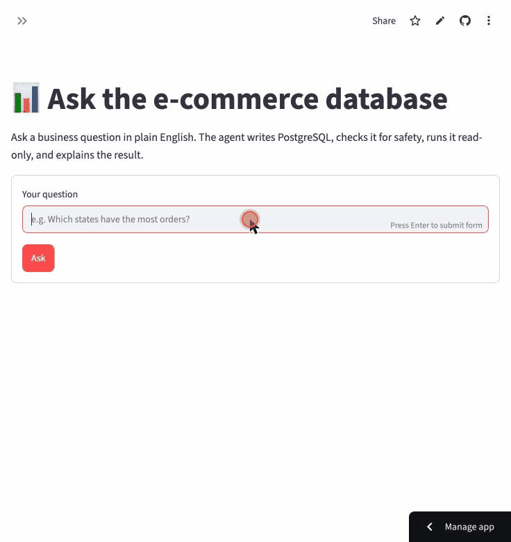
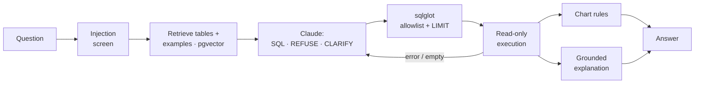

# Text-to-SQL Analytics Agent

[](https://github.com/Mandy8639/text-to-sql-agent/actions/workflows/ci.yml)

Ask a business question in plain English, like *"Which product categories brought in the most
revenue in 2017?"*, and get a correct PostgreSQL query, the result, a chart, and a short
explanation grounded in the returned numbers. The agent retrieves the relevant schema and
solved examples from pgvector, generates SQL with Claude, validates it with a sqlglot
allowlist, runs it on a read-only role, corrects itself on errors, and **refuses or asks for
clarification** instead of guessing. Every claim below is measured on a 123-question benchmark
with a leakage-guarded test split, plus a blind hold-out set written by someone who never saw
the prompts.

**Live demo:** _coming soon — see [docs/deployment.md](docs/deployment.md)_ (Hugging Face Spaces + Neon, free tier; may take ~1 min to wake)


<!-- GIF placeholder: record a 20-30 s screen capture of the UI and save it as docs/demo.gif -->

## Results

Test split: 88 questions (74 answerable, 14 should be refused or clarified). Each version adds
**one** technique ([app/agent/pipeline.py](app/agent/pipeline.py)).

| Version | Adds | Exec acc (Haiku 5.5) | Abstain acc | Exec acc (Opus 5.5) | Abstain acc | $ / question (Haiku) |
|---|---|---:|---:|---:|---:|---:|
| baseline | full schema doc in the prompt | 100% | 0% | 100% | 0% | $0.0010 |
| v2 | schema retrieval (pgvector) | 100% | 0% | – | – | $0.0010 |
| v3 | + 3 retrieved dev examples | 100% | 0% | – | – | $0.0009 |
| v4 | + self-correction (≤ 2 retries) | 100% | 0% | – | – | $0.0010 |
| **v5** | **+ clarify / refuse** | 98.6% | **100%** | **100%** | **100%** | $0.0009 |
| v6 | + safety layer | 98.6% | 100% | – | – | $0.0009 |
| **Blind hold-out** (20 questions, frozen v5) | | **19 / 20** | | **19 / 20** | | |
| | | | | | | |
| baseline, **no schema docs** | table/column names only | 79.7% | 0% | – | – | $0.0005 |
| **no schema docs + 3 examples** | | **98.6%** | 0% | – | – | $0.0005 |

What the numbers say:

1. **Clarify/refuse was the decisive step: abstention 0% → 100%** on both models, with zero false
   refusals. Before it, the model often *wrote* "there is no web-traffic data" and then returned
   a proxy query anyway, because SQL was its only way to reply.
2. **Examples can replace documentation.** On an undocumented schema, 3 retrieved examples lift
   accuracy from 79.7% to 98.6%: their SQL carries the business definitions (revenue = payments
   on non-canceled orders). This holds without near-duplicate examples (85.7% → 100%).
3. **With full documentation the benchmark hits its ceiling,** so retrieval, few-shot and
   self-correction show up as **cost and latency** gains (−12% input tokens; Opus p50
   3.4 s → 2.5 s), not accuracy. Self-correction fired once on the test set and hurt; on the
   hold-out it fixed a typo.
4. **The 100% is a ceiling, not a claim of perfection**: one author, and conventions partly shaped
   by test failures. Hence the **blind hold-out: 19/20 on both models**, whose single miss is
   a convention edge case ("average order value"), not a SQL error.
5. **Haiku matches Opus at about 1/33 of the cost** here, so the demo runs on Haiku.

Full history: [evals/results/summary.md](evals/results/summary.md) ·
failures: [docs/failure_analysis.md](docs/failure_analysis.md) ·
hold-out review: [evals/results/holdout_review.md](evals/results/holdout_review.md).

## How it works



1. **Screen** the question for prompt-injection phrasing (refused before any LLM call).
2. **Retrieve** the 6 most relevant table descriptions (plus the tables on the join path
   between them) and the 3 most similar *dev* questions with their SQL, from pgvector.
3. **Generate** SQL with Claude, or a `REFUSE:` / `CLARIFY:` reply.
4. **Validate** with sqlglot: one SELECT only, no write/DDL anywhere in the tree (even inside
   CTEs), `olist` tables only, no dangerous functions; a LIMIT is added.
5. **Execute** in a `READ ONLY` transaction with a timeout, as a role that can only SELECT.
   On an error, empty result or block, feed the problem back and retry (up to 2 times).
6. **Explain** the rows in plain English (Haiku). The rows are passed as untrusted data, and a
   grounding check flags any number not present in them. **Chart** by simple rules.

Details: [docs/architecture.md](docs/architecture.md) (component diagram, request lifecycle, failure paths).

## Key design decisions

| Decision | Why | More |
|---|---|---|
| **Benchmark before improvements**; result-set scoring; dev/test split enforced in code | So every change is measured, and test questions can never leak into prompts (the guard caught a real overlap) | D19–D22 |
| **Gold SQL follows written conventions** (A1–A8) | Two correct people otherwise write different SQL, and the score would measure disagreement | D26 |
| **Hardened the benchmark, then ablated the docs** when the baseline hit 96–98% | Harder questions didn't create headroom; removing docs showed where it really was | D23–D25 |
| **One configurable pipeline**, one technique per version, unit-tested | Keeps "add one technique at a time" checkable | D30 |
| **Allowlist SQL validator + read-only role + per-transaction READ ONLY** | Defense in depth: 55 attacks blocked, 0 false positives on 122 gold queries | D12, D33 |
| **Three database roles**: agent (read data), rag (read index), app (write spend counter only) | Generated SQL can't see the examples; the deployed app never holds admin credentials | D29, deployment.md |
| **Explanations grounded in the rows**, which are treated as untrusted | Review text is customer-written (indirect injection); invented numbers are flagged | D35 |
| **Langfuse behind a no-op-by-default tracer** | Full trace per question when configured; zero dependency when not | D34 |

All 36 decisions, with alternatives and tradeoffs: [docs/decisions.md](docs/decisions.md).

## Limitations and future work

- **One schema, 9 tables, English only.** Retrieval's token savings are small at this size (−12%).
  A larger schema would make table selection matter.
- **Conventions are the weak point:** the remaining misses are definitional ("average order
  value" with or without canceled orders). A proposed rule (A9) is pending.
- **Open-ended questions** (7 of the 20 hold-out) need rubric grading; an LLM judge calibrated
  on those reviews would scale this.
- **No follow-up questions** ("now by state"). Design and tradeoffs in D36.
- **Regex injection screening** misses paraphrases; the validator and read-only role are the real guards.

## Run it locally

Prerequisites: [uv](https://docs.astral.sh/uv/), Docker (Docker Desktop or OrbStack), `make`,
an [Anthropic API key](https://console.anthropic.com), and the
[Olist dataset](https://www.kaggle.com/datasets/olistbr/brazilian-ecommerce) (9 CSVs unzipped
into `data/raw/`).

```bash
make setup        # install deps; creates .env from .env.example
# edit .env: ANTHROPIC_API_KEY, and the passwords in POSTGRES_PASSWORD and the four *_URL lines
make db-up        # Postgres 16 + pgvector in Docker
make bootstrap    # load data (~10 s), build the retrieval index, create the spend counter
make run-api      # terminal 1: http://127.0.0.1:8000/docs
make run-ui       # terminal 2: http://127.0.0.1:8501
```

Or the whole stack in Docker: `make stack-up` (after `make bootstrap`).

Evaluate:

```bash
LLM_MODEL=claude-haiku-5-5 make eval AGENT=v6     # full test split, ~$0.09
make test                                          # 480+ tests; DB/LLM ones skip if unavailable
make retrieval-recall                              # retrieval quality, no LLM calls
```

| Command | What it does |
|---|---|
| `make bootstrap` | load data, build the index, create the spend table (all you need on a fresh DB) |
| `make run-api` / `make run-ui` | FastAPI (:8000, docs at `/docs`) / Streamlit (:8501) |
| `make stack-up` / `make stack-down` | db + api + ui in Docker |
| `make eval AGENT=<v> SPLIT=<s>` | evaluate a version (`baseline`, `v2`…`v6`, `raw-fewshot`) on `dev`, `test` or `holdout` |
| `make validate-gold` | run every gold query |
| `make test` / `make test-unit` / `make lint` | tests / tests without services / ruff |
| `python -m evals.rescore <run.json>` | re-grade a stored run after a gold fix (no API cost) |
| `python -m evals.compare_runs A.json B.json` | which questions a change fixed or broke |

**API:** `POST /query {"question": "..."}` returns the outcome (answer / clarify / refuse /
error), explanation, SQL, rows, chart spec, reasoning steps, trace id, latency and cost.
`POST /feedback`, `GET /health`, `GET /schema`. Limits: 3–500 characters, per-visitor and global
rate limits, and a daily spend cap.

## Project layout

```
app/          agent/ (baseline, pipeline v2-v6, prompts), retrieval/, safety/, observability/,
              db/, llm/, service.py, charts.py, explain.py, spend.py, config.py
api/          FastAPI app
ui/           Streamlit app (talks to the API over HTTP)
evals/        questions.yaml, holdout.yaml, leakage guard, scoring, harness, results/
scripts/      data load, retrieval index, spend table, Space deploy
docs/         schema.yaml, decisions, architecture, failure analysis, deployment, data profile
docker/       API / UI / Space Dockerfiles, Postgres init
tests/        unit/ (no services; run in CI) and integration/ (Postgres, index, LLM)
```

Configuration is all environment variables: see [.env.example](.env.example) and
[app/config.py](app/config.py). Data cleaning and profile: [docs/data.md](docs/data.md).

## Tech stack

Python 3.12 · uv · PostgreSQL 16 + pgvector · SQLAlchemy · sqlglot · Claude (Opus 5.5 / Haiku 5.5)
via the Anthropic SDK · fastembed (bge-small-en-v1.5) · FastAPI · Streamlit · Langfuse ·
pytest · ruff · Docker · GitHub Actions
