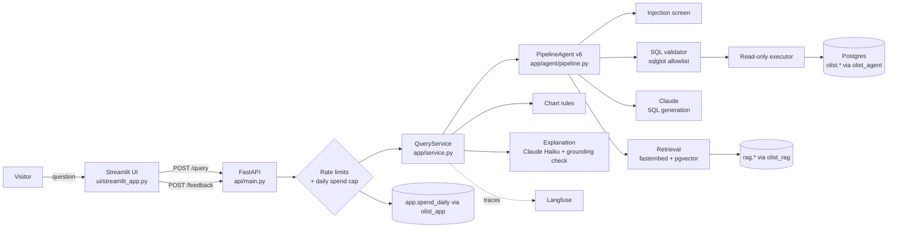
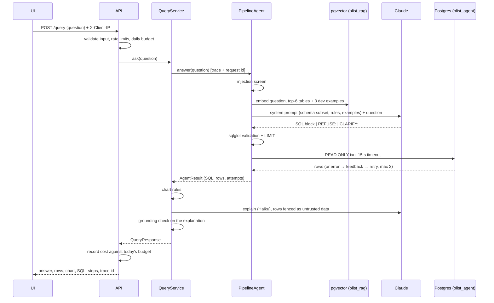

# Architecture

## Components

The live demo runs the same QueryService inside Streamlit (`UI_MODE=inprocess`) with the same
limits, so there the HTTP hop is absent; see docs/deployment.md.

Three database roles, each with the least privilege for its job: `olist_agent` (SELECT on the
business data), `olist_rag` (SELECT on the retrieval index), `olist_app` (write to the spend
counter only). The admin role is used only by the loading scripts.

## Request lifecycle

Example: *"What was the total revenue in each month from January to August 2018?"*

### Step by step

| # | Step | Code | Notes |
|---|---|---|---|
| 1 | **Input validation** | `api/main.py` `QueryRequest` | 3–500 chars, whitespace collapsed, control characters rejected |
| 2 | **Rate limits** | `RateLimiter`, `client_key` | per visitor (forwarded IP trusted only from the container) and global |
| 3 | **Daily budget** | `app/spend.py` | 503 once today's LLM spend reaches the cap; stored in Postgres |
| 4 | **Request id + trace** | `app/observability` | one id in every log line; one Langfuse trace per question |
| 5 | **Injection screen** | `app/safety/injection.py` | override/reveal/role-switch phrasing is refused before any LLM call |
| 6 | **Schema retrieval** | `app/retrieval` | top-6 tables by cosine similarity (k chosen on dev recall: 100%), plus join-path tables over enforced FKs; a one-line map of all tables is always included |
| 7 | **Few-shot examples** | `VectorStore.search_examples` | 3 nearest **dev** questions with gold SQL; ids recorded and checked against test |
| 8 | **Generation** | `PipelineAgent`, `prompts/agent_abstain_v1.md` | reply is SQL, `REFUSE:` or `CLARIFY:` |
| 9 | **Validation** | `app/safety/sql_validator.py` | one SELECT; no writes/DDL/utilities anywhere in the tree; olist tables only; no dangerous functions; LIMIT added |
| 10 | **Execution** | `app/db/executor.py` | `SET TRANSACTION READ ONLY` + statement timeout per call; capped fetch |
| 11 | **Self-correction** | `_handle_reply` | on error / no SQL / empty / all-NULL / blocked: feedback and retry (≤ 2) |
| 12 | **Chart** | `app/charts.py` | time → line, category → bar, single value → metric, else table |
| 13 | **Explanation** | `app/explain.py` | Haiku; rows inside `<data>` as untrusted; numbers checked against the rows |
| 14 | **Response + spend** | `api/main.py` | cost recorded; UI renders answer, chart, table, SQL, steps, feedback |

### Failure paths

| Situation | What the user sees | Where it shows up |
|---|---|---|
| Destructive or unanswerable request | "I can't answer that: …" (refuse) | trace output, `outcome=refuse` |
| Too vague | the agent's clarifying question | `outcome=clarify` |
| Injection attempt | refusal, no LLM call made | `injection_screen` step, `injection.blocked` log |
| SQL blocked by validator | retried; if it still fails, a fixed message | `validate` step with the reason |
| Postgres error | retried with the error; else a fixed message | `execute` step, `sql.error` log |
| Explanation invents a number | warning listing the ungrounded numbers | `explain` step metadata |
| Rate limit / budget | 429 / 503 with a plain message | API logs |
| Unexpected exception | "Internal error" + error id (no details) | `api.error` log with the details |

## Offline pieces

- **Data load** (`scripts/load_data.py`): CSV → TEXT staging → typed `olist` schema, in one transaction.
- **Index build** (`scripts/build_index.py`): table docs (+ the business rules that mention
  each table) and dev examples → embeddings → `rag.*`.
- **Evaluation** (`evals/`): benchmark (dev/test/hold-out), leakage guard, result-set scoring,
  run files with per-question rows and trace ids, free rescoring, `summary.md`.
